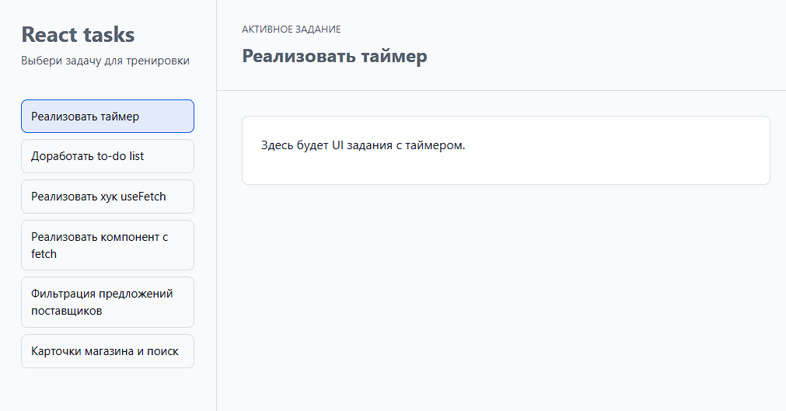

# React + TypeScript Training Sandbox

Песочница для практики JavaScript, TypeScript и React. Здесь можно написать хук, собрать интерфейс или разобрать код из задачи с собеседования.

## Быстрый старт

Первое упражнение — «Первый отложенный вызов». Для него понадобятся редактор кода и Node.js.

1. **Открой проект.** В редакторе открой папку `my-react-sandbox`, где рядом с этим README находятся `package.json` и `src`.
2. **Прочитай [условие упражнения](./src/tasks/js-basics/timeout-basics/task.md).** Для первого прохождения достаточно раздела перед заголовком «Следующий шаг с функцией и браузером».
3. **Запусти [рабочий файл timer.js](./src/tasks/js-basics/timeout-basics/attempts/current/timer.js).** Открой терминал в папке проекта и выполни команду:

   ```sh
   node src/tasks/js-basics/timeout-basics/attempts/current/timer.js
   ```

   В исходной заготовке строки «Старт» и «Можно запускать поиск» появятся сразу.
4. **Измени и проверь.** В том же `timer.js` сделай так, чтобы второе сообщение появлялось через секунду. Сохрани файл и повтори команду. Если «Старт» появился сразу, а второе сообщение — один раз после паузы, первый шаг выполнен.

## Каталог задач

Выбери раздел, открой папку интересующей задачи и прочитай её `task.md`.

| Раздел | Что будешь практиковать |
| --- | --- |
| [JavaScript в консоли](./src/tasks/js-basics/) | Функции и поведение JavaScript. Результат виден в терминале. |
| [Компоненты и интерфейс](./src/tasks/components/) | Создание экранов, запросы данных и обработку действий пользователя. |
| [Хуки](./src/tasks/hooks/) | Реализацию хуков с заданным поведением. Пример — [булево состояние с переключением](./src/tasks/hooks/use-toggle/task.md). |
| [Разбор и рефакторинг](./src/tasks/review/) | Поиск ошибок в готовом коде, объяснение причин и проверку исправлений. |

### Как проверить задачу в браузере

Для упражнений с интерфейсом понадобятся Node.js и pnpm. Если песочница уже запущена, открой её вкладку и выбери задание по названию. Для первого запуска:

1. В терминале из папки проекта выполни `pnpm install` и дождись завершения установки.
2. Выполни `pnpm dev`. Оставь этот терминал открытым, пока работаешь с экраном.
3. Перейди по адресу из строки `Local` и выбери свою задачу. При следующем запуске начни со второго шага.



## Где писать код

| Файл или папка | Назначение |
| --- | --- |
| `task.md` | Условие упражнения и указания по работе. |
| Рабочий файл рядом с `task.md` | Здесь пишешь решение в новом формате. Открой его по ссылке в условии. |
| `attempts/current/` | Рабочие файлы заданий старого формата. |
| `starter/` | Чистая заготовка, из которой можно восстановить рабочий файл. |
| `hint.md` | Подсказка, если она предусмотрена автором. |

## Как добавить свою задачу

В терминале из корня проекта выполни `pnpm task:new`. Укажи название, раздел и имя рабочего файла. Команда создаст пустой черновик автора и покажет путь к условию. После подготовки задания обнови исходную копию в `starter/` и подключи готовое упражнение к каталогу.

Как сохранить попытку или начать упражнение заново, описано в [руководстве по работе с задачами](./TASKS.md).
